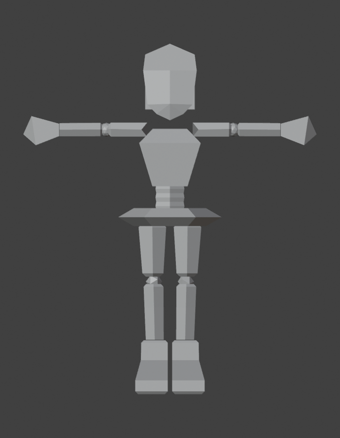

# Emotion-Driven VTuber Avatars

Facial emotion recognition from video, used to change the expression of a VTuber avatar automatically.
The project compares **frame-based** and **sequence-based** deep learning models on the video-only part of
[RAVDESS](https://doi.org/10.5281/zenodo.1188976), with seven classes: neutral (calm merged in), happy, sad,
angry, fearful, disgust and surprised.

Course project for *Introduction to Deep Learning*, Atatürk University (2026).

| Approach | Models |
|---|---|
| Baseline | Simple CNN trained from scratch |
| Frame-based | ResNet-18, MobileNetV2 (ImageNet-pretrained) |
| Sequence-based | ResNet-18 / MobileNetV2 + LSTM or Transformer |

## Status and plan

| Week | Deep learning | 3D avatar | Status |
|---|---|---|---|
| 4 | Setup, data index, actor-wise split, dataset analysis | – | ✅ done |
| 5 | – | Low-poly full-body model in T-pose | ✅ done |
| 6 | Preprocessing (face detection, frame sampling, cropping), EDA figures, baseline CNN, ResNet-18, **progress report** | – | ⏳ next |
| 7 | Progress report submission, MobileNetV2 | Rig (VRM humanoid skeleton) | planned |
| 8 | Sequence models (CNN + LSTM / Transformer), control model | Textures, seven expressions, VRM export | planned |
| 9–11 | Experiments (frame count, pretrained vs. scratch, augmentation), ablation, 6-fold cross-validation | – | planned |
| 11–12 | Error analysis, Grad-CAM, attention maps | Webcam → emotion model → avatar demo | planned |
| 13–14 | Final report, presentation | Live demo | planned |

The progress report only covers the work up to week 6. All results in it are on the validation actors; the test
actors stay locked until model development is finished.

## Repository structure

```
├── data/
│   ├── README.md        how to download and prepare RAVDESS
│   ├── metadata/        clip index, actor folds, video properties (tracked)
│   ├── raw/             RAVDESS videos (not tracked)
│   └── processed/       face crops (not tracked)
├── src/
│   ├── config.py        all paths and the global seed
│   ├── utils.py         set_seed, DataLoader helpers, device selection
│   ├── build_index.py   clip index from the RAVDESS file names
│   ├── splits.py        gender-balanced actor folds, fixed split, test lock
│   └── eda.py           video properties, dataset summary table, figures
├── results/
│   ├── figures/
│   └── tables/
├── report/
│   ├── proposal/        project proposal (LaTeX + PDF)
│   └── progress/        progress report (LaTeX)
├── docs/notlar.md       working notes: problem log and decisions (Turkish)
├── notebooks/           exploratory notebooks
├── models/              checkpoints (not tracked)
└── avatar/
    ├── README.md        what the files are, plan for rig and expressions
    ├── vtuber_avatar.blend   low-poly model (Blender 5.2), T-pose
    └── previews/        front and side renders
```

## Demo avatar



The live demo needs a 3D model whose expression can be switched by the classifier. The model is built from scratch
in Blender and will be exported as **VRM**, the common format of 3D VTuber software. VTube Studio, mentioned in the
proposal, supports only 2D (Live2D) models, so the avatar will be shown in a small web viewer based on
[`three-vrm`](https://github.com/pixiv/three-vrm) instead. Each of the seven predicted classes triggers one avatar
expression. See [avatar/README.md](avatar/README.md).

<br clear="right">

## Setup

Requirements: Python 3.13 and ffmpeg (`ffprobe` is used to read video properties).
Developed on macOS with an Apple M5 GPU (PyTorch MPS backend); CPU and CUDA also work.

```bash
python3 -m venv .venv
source .venv/bin/activate
pip install -r requirements.txt
```

## Data

The videos are not part of this repository. Download and extract them as described in
[data/README.md](data/README.md).

## Reproducing the results

Run from the repository root:

```bash
python src/build_index.py   # data/metadata/index.csv
python src/splits.py        # data/metadata/splits.json
python src/eda.py           # data/metadata/video_meta.csv, results/tables/, results/figures/
```

Every script checks the expected counts (1,440 clips, 60 per actor, 288 neutral and 192 clips for every other
class, 2 male + 2 female actors per fold) and stops with an error if one of them does not hold.

To build the progress report:

```bash
cd report/progress && latexmk -pdf progress.tex
```

## Reproducibility

- **Seed:** 4206, defined once in `src/config.py`. `utils.set_seed()` fixes Python, NumPy and PyTorch.
- **Versions:** pinned in `requirements.txt`.
- **Actor-wise split:** six folds of four actors (two male, two female), stored in `data/metadata/splits.json`.
  During development the first round is used as a fixed split:

  | Set | Actors | Clips |
  |---|---|---|
  | Train | the remaining 16 actors | 960 |
  | Validation | 3, 12, 21, 24 | 240 |
  | Test | 4, 6, 7, 23 | 240 |

  The test actors are locked until model development is finished: `splits.load_split()` returns the test set
  only with `allow_test=True`.

## Dataset and licence

RAVDESS is released under [CC BY-NC-SA 4.0](https://creativecommons.org/licenses/by-nc-sa/4.0/) and is used here
for non-commercial academic work only. The videos are not redistributed.

> S. R. Livingstone and F. A. Russo, "The Ryerson Audio-Visual Database of Emotional Speech and Song (RAVDESS):
> A dynamic, multimodal set of facial and vocal expressions in North American English," *PLoS ONE*, vol. 13,
> no. 5, e0196391, 2018.

The code in this repository is released under the [MIT License](LICENSE).

## Author

Ömer Sunguralp Bektaş, Artificial Intelligence and Data Engineering, Atatürk University
